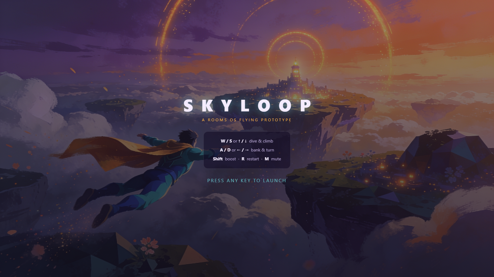

# SKYLOOP

**An original browser flying mini-game built with Three.js — fly through 12 sky rings against the clock.**

### ▶ [Play it in your browser](https://koltregaskes.github.io/skyloop/)

No install, no build step — it's a single HTML page that loads Three.js from a
CDN, so it runs on GitHub Pages or any static host. Just open the link above.



It reproduces the pattern from the public *SUPERFLIGHT* concept (flying hero +
generated world + camera polish + bloom/grain + an objective) as a fully
**original** build — no protected IP. The hero, world, and effects are generated
in code; the key art and music are AI-generated by the author (provenance in
[`assets/GENERATED-ASSETS.md`](assets/GENERATED-ASSETS.md)).

## What it is

A small browser mini-game built with Three.js (r184, loaded from a CDN):

- **Hero**: "Drift", an original low-poly flying hero (indigo-teal suit, amber
  vertex-animated cape, cyan visor, boot thrusters, fading light trail).
- **World**: "Aurora Shoals", a seeded procedural World Labs-style dreamscape —
  34 floating islands (crystal, town, and grove variants), a central beacon
  island, drifting clouds, a sea plane, and a dusk gradient sky dome.
- **Flying controller**: pitch/turn with banking roll, gentle auto-level,
  dive speed bonus, Shift boost.
- **Camera polish**: smoothed chase camera, FOV zoom on boost, camera shake on
  boost and ring collection.
- **Post-processing**: UnrealBloomPass + custom film grain/vignette pass +
  ACES tone mapping (grain and bloom ramp up with boost).
- **Objective loop**: fly through all 12 sky rings (each marked with a light
  beam and an edge-of-screen marker showing distance to the nearest ring).
  Scoring: 100 points per ring × a combo multiplier (chain rings within 8
  seconds), +50 for collecting while boosting. Timer, best time and best score
  in localStorage, win screen, R to restart.
- **City hub**: the central beacon island is a small procedural city
  (18 towers with lit window strips) — the source author's "larger city"
  improvement, done without assets.
- **GLB character swap (verified)**: `?model=./assets/fox.glb` replaces the
  procedural hero with the CC0 Khronos Fox sample — auto-centred, auto-scaled,
  first fly/run/walk animation playing, banking inherited. This proves the
  Fab/GLB import path end to end (see `assets/FOX-LICENCE.md`).
- **Audio engine** (`src/audio.js`): looping Magnific-generated music bed,
  ambient wind that rises with boost, ring/boost/win cues. Cues are synthesised
  live but auto-upgrade to generated samples listed in
  `assets/audio/manifest.json`. Press **M** to mute.
- **Generated art**: the start and win screens use original key art generated
  via the Magnific MCP; the flight music is ElevenLabs-via-Magnific. Full
  provenance and prompts in `assets/GENERATED-ASSETS.md`.

## Controls

| Key | Action |
|---|---|
| W / S or ↑ / ↓ | dive / climb |
| A / D or ← / → | bank and turn |
| Shift | boost |
| R | restart · **M** mute |

## Run it locally

It's static files, so any web server works. With Python:

```bash
git clone https://github.com/koltregaskes/skyloop.git
cd skyloop
npm run serve        # python -m http.server 8431
# open http://127.0.0.1:8431/
```

URL options: `?seed=12` regenerates the world; `?model=<url-to.glb>` swaps the
procedural hero for any licensed GLB character (try `?model=./assets/fox.glb`,
the bundled CC0 Khronos Fox). See [`PIPELINE.md`](PIPELINE.md).

## Verification

```bash
npm install          # installs Playwright (the only dev dependency)
npm run serve        # in one terminal
npm run verify       # in another — drives the real game headlessly
```

`scripts/verify-capture.mjs` launches headless Chromium and asserts the real
mechanics: launch, boost, banking, all 12 rings collected through the live
collision code, scoring/combo, win, restart, the audio engine, the GLB swap, and
zero console errors (11 checks). It writes screenshots + a flight video +
`verification-current.json` to `evidence/`.

## Project layout

| Path | What |
|---|---|
| `index.html` | page shell, HUD, overlays, CDN import map |
| `src/main.js` | the engine — world gen, hero, controller, camera, post, objective |
| `src/audio.js` | audio engine (music bed + synth SFX + ambient) |
| `assets/` | fox.glb (CC0), generated key art + music, audio manifest |
| `scripts/verify-capture.mjs` | headless browser verification |
| `PIPELINE.md` | Unreal/Fab/MetaHuman → web GLB asset pipeline guide |
| `assets/GENERATED-ASSETS.md` | provenance + prompts for the generated art & music |

## Licence

Code is MIT ([`LICENSE`](LICENSE)). Bundled assets keep their own terms — the
Fox is CC0; the key art and music are author-generated (see
[`assets/GENERATED-ASSETS.md`](assets/GENERATED-ASSETS.md)).
