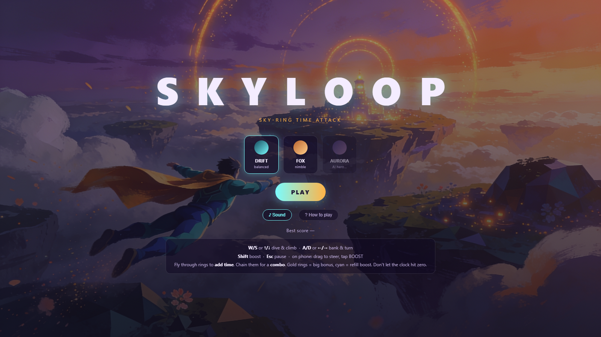

# SKYLOOP

**An original browser arcade flying game built with Three.js — race an endless sky-ring course against the clock, chase combos, and earn your rank.**

### ▶ [Play it in your browser](https://koltregaskes.github.io/skyloop/)

No install, no build step — a single HTML page that loads Three.js from a CDN, so it runs on GitHub Pages or any static host. Works on desktop and phone.



It started from the public *SUPERFLIGHT* concept (flying hero + generated world + camera polish) and grew into a full arcade game — all **original**, no protected IP. The hero, world, and effects are generated in code; the key art, music, and the AI 3D hero are AI-generated by the author (provenance in [`assets/GENERATED-ASSETS.md`](assets/GENERATED-ASSETS.md)).

## How to play

Fly through rings to **add time** to the clock. Chain rings without missing to build a **combo multiplier** — the longer the chain, the bigger the score. Pass through a ring's **centre** for a PERFECT bonus. When the clock hits zero the run ends and you get a **rank (S–D)**. Beat your best score.

Ring types:
- **Amber** — standard: adds time and score.
- **Gold** — rare, smaller: big score + time bonus.
- **Cyan** — boost gate: refills your boost meter.

Boost (Shift) is a resource — it drains as you use it and recharges over time, so spend it to reach distant rings or rack up speed, and grab cyan gates to top up.

## Controls

| | Keyboard | Touch |
|---|---|---|
| Dive / climb | W / S or ↑ / ↓ | drag the left stick |
| Bank & turn | A / D or ← / → | drag the left stick |
| Boost | Shift | BOOST button |
| Pause | Esc / P | ⏸ button |
| Mute | M | ♪ in the menu |

Three characters: **Drift** (the original procedural hero), **Fox** (a CC0 sample), and **Aurora** (an AI-generated 3D hero — concept image → image-to-3D).

## Run it locally

```bash
git clone https://github.com/koltregaskes/skyloop.git
cd skyloop
npm run serve        # python -m http.server 8431
# open http://127.0.0.1:8431/
```

`?seed=12` regenerates the course; `?model=<url.glb>` swaps in any GLB hero.

## Verification

```bash
npm install          # Playwright (only dev dependency)
npm run serve        # one terminal
npm run verify       # another — drives the real game headlessly
```

`scripts/verify-capture.mjs` launches headless Chromium and asserts the full game: menu load, autopiloted flight, ring collection through the live collision/collect code, scoring + combo, time extension, dynamic music, pause/resume, character swaps (incl. the AI 3D hero), and run-end to a graded results screen — 14 checks, zero console errors. Screenshots + a video + `verification-current.json` land in `evidence/`.

## Project layout

| Path | What |
|---|---|
| `index.html` | shell, HUD, menu/countdown/pause/results screens, touch UI |
| `src/main.js` | the engine — state machine, world gen, hero, controller, endless ring course, juice, camera, post |
| `src/audio.js` | audio engine — menu/gameplay music crossfade, SFX, ambient |
| `assets/` | fox.glb (CC0), AI 3D hero, generated key art + music, manifests |
| `scripts/verify-capture.mjs` | headless browser verification |
| `assets/GENERATED-ASSETS.md` | provenance + prompts for the generated art, music & 3D hero |
| `PIPELINE.md` | Unreal/Fab/MetaHuman → web GLB asset pipeline guide |

## Licence

Code is MIT ([`LICENSE`](LICENSE)). Bundled assets keep their own terms — the Fox is CC0; the key art, music, and AI 3D hero are author-generated (see [`assets/GENERATED-ASSETS.md`](assets/GENERATED-ASSETS.md)).
